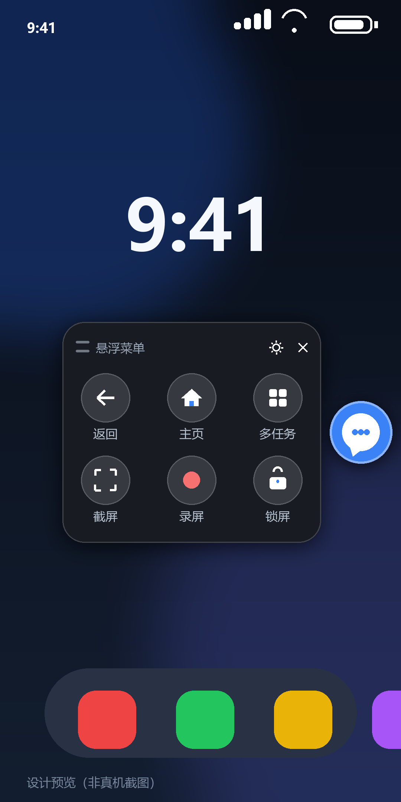

# 悬浮助手 FloatKit

一款轻量的 Android 悬浮窗小工具：**一颗常驻屏幕边缘的悬浮球**，点开即可返回、回主页、多任务、截屏、录屏、锁屏。前台服务 + 看门狗 + 开机自启，尽量长时间在后台存活。

- 最低支持：**Android 7.0（API 24）**
- 已适配：Android 7 ~ Android 15（targetSdk 33）
- 体积：约 120 KB，**零第三方依赖**（不使用 AndroidX、不联网、没有 INTERNET 权限）



> 上图是按代码实际尺寸（悬浮球 56dp、菜单 232dp 宽、3×2 按钮）绘制的设计预览，不是真机截图。

> 说明：本仓库交付的是 **完整可编译的 Android Studio 工程源码**。当前工作环境没有安装 JDK / Android SDK，无法在这里直接产出 APK，因此提供了三种构建方式（Android Studio / Windows 一键脚本 / GitHub Actions 云端出包）。工程本身是完整、可独立构建的。

---

## 1. 功能一览

| 功能 | 说明 |
| --- | --- |
| 悬浮球 | 56dp 圆形，可拖动到任意位置，松手自动贴边（可关），位置会记忆 |
| 展开菜单 | 点击悬浮球，在球旁边弹出 3×2 功能面板，6 秒无操作自动收起 |
| 返回 / 主页 / 多任务 | 通过无障碍服务的 `performGlobalAction` 实现 |
| 锁屏 | `GLOBAL_ACTION_LOCK_SCREEN`，需要 Android 9+ |
| 截屏 | MediaProjection + ImageReader，PNG 保存到相册 `Pictures/FloatKit` |
| 录屏 | MediaProjection + MediaRecorder，H.264 MP4 保存到相册 `Movies/FloatKit`，可选麦克风声音 |
| 录屏停止 | 通知栏常驻通知上的「停止录屏」按钮（录屏时悬浮球默认自动隐藏） |
| 后台存活 | 前台服务常驻通知、`START_STICKY`、任务移除后重启、15 分钟看门狗、开机自启、电池白名单引导、录屏 WakeLock |
| 隐私 | 无 INTERNET 权限，代码中没有任何网络请求；截图/录像只写本机相册 |

---

## 2. 构建（三选一）

### 方式 A：Android Studio（推荐）

1. 安装 [Android Studio](https://developer.android.com/studio)（Giraffe / Hedgehog 或更新版本均可，自带 JDK 17+）。
2. `File → Open`，选择本 `FloatKit` 目录。
3. 等待 Gradle Sync（首次会联网下载 Gradle 8.7 与 AGP 8.5.2，约 200 MB）。
   - 若提示缺少 `gradle/wrapper/gradle-wrapper.jar`：执行一次 `build-apk.bat`（方式 B）即可补齐 `gradlew`，或在 Studio 的
     `Settings → Build, Execution, Deployment → Build Tools → Gradle` 里把 Gradle 发行版指到本地 Gradle 8.7。
4. 运行：连上手机，点绿色 ▶ 即可安装调试；或 `Build → Build Bundle(s)/APK(s) → Build APK(s)`。
5. 产物：`app/build/outputs/apk/debug/app-debug.apk`。

### 方式 B：Windows 一键脚本

前置条件：已安装 Android Studio（提供 JDK 与 SDK）或已自行安装 JDK 17+ 与 Android SDK；能联网。

```bat
build-apk.bat
```

脚本会自动：找 JDK → 找 Android SDK 并写 `local.properties` → 下载 Gradle 8.7 到 `.buildtools\` → 编译 debug APK → 复制到 `dist\FloatKit-debug.apk`。

### 方式 C：GitHub Actions 云端出包（本机零环境）

1. 把本工程推到 GitHub 仓库（确保 `.github/workflows/build.yml` 一起提交）。
2. 仓库 `Actions` 页 → `Build APK` → `Run workflow`。
3. 运行完成后在该次运行页面底部下载 `FloatKit-debug-apk` 产物。

---

## 2.1 两个常见坑（新版 Android Studio / 国内网络必读）

- **JDK 版本**：本项目固定 `AGP 8.5.2 + Gradle 8.7`，要求用 **JDK 17**（或 21）运行 Gradle。新版 Android Studio（2025.3+ / 2026.x）自带的 JBR 可能是 JDK 21/25，直接同步会报 `Could not determine java version from '25'` 之类错误。解决：`Settings → Build, Execution, Deployment → Build Tools → Gradle → Gradle JDK` 选择或 `Download JDK` 一个 **17**。命令行方式则把 `JAVA_HOME` 指向 JDK 17（`build-apk.bat` 优先使用 `%JAVA_HOME%`）。
- **国内网络**：`google()` / `mavenCentral()` 与 `services.gradle.org` 在国内可能无法访问。已在 [settings.gradle](settings.gradle) 和 [gradle/wrapper/gradle-wrapper.properties](gradle/wrapper/gradle-wrapper.properties) 中以注释形式内置了阿里云 Maven 镜像与腾讯 Gradle 镜像，按注释切换即可；Android SDK 若下载失败，可在 SDK Manager 里配置镜像或挂代理。

---

## 3. 安装与首次使用

1. 安装 APK（需要允许「安装未知来源应用」）。
2. 打开「悬浮助手」，按提示逐项授权：
   - **悬浮窗权限**：系统设置里打开「允许显示在其他应用上层」；
   - **无障碍服务**：系统设置 → 无障碍 → 已下载的应用 → 「悬浮助手 · 系统操作」→ 开启（返回/主页/多任务/锁屏需要）；
   - **通知 / 麦克风 / 存储**：点「授权」一次性申请（通知用于常驻通知，麦克风用于录屏声音，存储仅 Android 9 及以下需要）；
   - **后台运行保护**：加入电池优化白名单。
3. 点「启动悬浮窗」，App 自动返回桌面，屏幕边缘出现蓝色悬浮球。
4. 点击悬浮球 → 展开菜单；拖动悬浮球可移动；松手自动贴边。
5. 截屏 / 录屏第一次会弹出系统授权框：勾选 **「整个屏幕」** 并允许（Android 14+ 每次截屏/录屏都会重新询问，这是系统限制）。

---

## 4. 后台保活：已实现什么、还能怎么加强

已实现：

- `startForeground()` 常驻通知（低优先级、不可滑动清除的 ongoing 通知）；
- `onStartCommand` 返回 `START_STICKY`，进程被杀后系统会尝试重建；
- `onTaskRemoved()`（用户从最近任务划掉 App）后通过闹钟 2 秒内自拉起；
- `AlarmManager` 15 分钟看门狗：发现服务不在就重新启动；
- `BOOT_COMPLETED` 开机自启 + `MY_PACKAGE_REPLACED` 升级后自启；
- 电池优化白名单引导（`REQUEST_IGNORE_BATTERY_OPTIMIZATIONS`）；
- 录屏期间持有 `PARTIAL_WAKE_LOCK`，避免 CPU 休眠导致录像中断；
- 前台服务声明 `foregroundServiceType="mediaProjection"`，满足 Android 10+ 使用 MediaProjection 的前台服务要求。

仍可能被杀的情况（所有悬浮窗类 App 都绕不开）：

- 用户在系统设置里「强行停止」，或从最近任务卡片上滑清理（部分 ROM 会连服务一起杀）；
- 国产 ROM 的自启动管理 / 后台清理 / 省电策略；
- Android 12+ 在后台启动前台服务的限制（代码里已 try/catch 并退化为通知提醒，点通知即可恢复）。

建议的厂商设置（每项都设置在「应用管理 → 悬浮助手」里）：

| 品牌 | 设置项 |
| --- | --- |
| 小米 / Redmi (MIUI/HyperOS) | 自启动 → 开；省电策略 → 无限制；锁定后台任务 |
| 华为 / 荣耀 (EMUI/MagicOS) | 应用启动管理 → 手动管理 → 全部允许；忽略电池优化 |
| OPPO / 一加 (ColorOS) | 允许自启动；允许后台活动；电池 → 不优化 |
| vivo / iQOO (OriginOS) | 自启动 → 开；后台高耗电 → 允许 |
| 三星 (One UI) | 电池 → 后台使用限制 → 从「休眠应用」中移除 |

---

## 5. 权限说明

| 权限 | 用途 |
| --- | --- |
| `SYSTEM_ALERT_WINDOW` | 显示悬浮球 / 菜单（必需） |
| `BIND_ACCESSIBILITY_SERVICE`（无障碍服务） | 返回 / 主页 / 多任务 / 锁屏 |
| `FOREGROUND_SERVICE` + `FOREGROUND_SERVICE_MEDIA_PROJECTION` | 前台服务常驻、MediaProjection 录屏 |
| `POST_NOTIFICATIONS` | Android 13+ 显示常驻通知 |
| `RECORD_AUDIO` | 录屏时录制麦克风（可选，拒绝也能无声录屏） |
| `WRITE_EXTERNAL_STORAGE`（仅 ≤ Android 9） | 把截图/录像写入公共相册 |
| `RECEIVE_BOOT_COMPLETED` | 开机自启 |
| `REQUEST_IGNORE_BATTERY_OPTIMIZATIONS` | 申请加入电池优化白名单 |
| `WAKE_LOCK` | 录屏期间保持 CPU 唤醒 |

无障碍服务只调用 `performGlobalAction()` 执行系统级动作，配置为**不读取窗口内容**（`canRetrieveWindowContent="false"`），不做任何数据采集。

---

## 6. 技术实现要点

- **悬浮窗**：`WindowManager.addView` + `TYPE_APPLICATION_OVERLAY`（API 26+）/ `TYPE_PHONE`（API 24-25）；`FLAG_NOT_FOCUSABLE | FLAG_LAYOUT_IN_SCREEN`，手动做边界与状态栏避让。
- **拖动与点击**：自定义 `OnTouchListener`，以 `ViewConfiguration.getScaledTouchSlop()` 区分拖动/点击；松手用 `ValueAnimator` 做贴边动画。
- **截图**：`MediaProjection` + `ImageReader`（`PixelFormat.RGBA_8888`），处理 `rowStride` 行补齐后转 `Bitmap`，写入 MediaStore（Android 10+）或公共 Pictures 目录（Android 7-9）。
- **录屏**：`MediaRecorder`（SURFACE 输入 + H.264 + 可选 AAC），宽度上限 1920 且宽高取偶数，避免编码器不支持的尺寸；停止后把临时文件拷贝进相册。
- **一次性授权**：每次截屏/录屏都单独走一次 `MediaProjectionManager.createScreenCaptureIntent()`，兼容 Android 14 的「每次共享都要用户确认」；`ProjectionRequestActivity` 是透明中转页，负责拿结果回传给服务。
- **无障碍**：`AccessibilityService.performGlobalAction`，锁屏用 API 28 的 `GLOBAL_ACTION_LOCK_SCREEN`。
- **targetSdk 33**：规避 Android 14 对 targetSdk 34+ 应用的「前台服务类型强校验 + 媒体投屏类型启动限制」；同时 minSdk 24 覆盖 Android 7。

---

## 7. 源码结构

```
FloatKit/
├─ build.gradle                     # AGP 8.5.2
├─ settings.gradle
├─ gradle.properties
├─ gradle/wrapper/gradle-wrapper.properties
├─ build-apk.bat                    # Windows 一键构建
├─ .github/workflows/build.yml      # 云端构建 APK
├─ docs/preview.png                 # 设计预览图
├─ tools/make_icons.py              # 生成启动图标 PNG
├─ tools/make_preview.py            # 生成本 README 的设计预览图
└─ app/
   ├─ build.gradle                  # compileSdk 34 / minSdk 24 / targetSdk 33，无依赖
   └─ src/main/
      ├─ AndroidManifest.xml
      ├─ java/com/floatkit/panel/
      │  ├─ MainActivity.java               # 权限引导 + 设置界面
      │  ├─ FloatingService.java            # 前台服务：生命周期/通知/动作分发/相机式协调
      │  ├─ OverlayUI.java                  # 悬浮球 + 功能菜单 + 拖动/贴边
      │  ├─ CaptureEngine.java              # 截图 / 录屏 / 相册保存
      │  ├─ ProjectionRequestActivity.java  # 屏幕共享授权透明中转页
      │  ├─ AutoAccessibilityService.java   # 返回/主页/多任务/锁屏
      │  ├─ BootReceiver.java               # 开机自启
      │  ├─ Watchdog.java / WatchdogReceiver.java  # 后台存活看门狗
      │  ├─ Notifier.java                   # 通知渠道与常驻通知
      │  ├─ Prefs.java                      # 偏好设置
      │  └─ Ui.java                         # dp / 屏幕尺寸 / 圆角背景等工具
      └─ res/…                              # 深色主题、图标、布局
```

### 想改点什么？

- **加/删菜单按钮**：`OverlayUI.buildPanel()` 里 `makeItem(图标, 文字, ACTION_*)`，再在 `FloatingService.onAction()` 里处理。
- **改配色**：`res/values/colors.xml`；菜单/悬浮球颜色在 `OverlayUI` 顶部的常量（`ACCENT` 等）。
- **改悬浮球大小**：`OverlayUI.BUBBLE_SIZE_DP`。
- **改菜单自动收起时间**：`Prefs.collapseSeconds()`（默认 6 秒，返回 0 表示不自动收起）。
- **改录屏分辨率上限**：`CaptureEngine.startRecording()` 里的 `1920` 与码率计算。
- **支持 Android 14+ 新前台服务规则**：把 `app/build.gradle` 的 `targetSdk` 改成 34，并给 `<service android:foregroundServiceType>` 增加所需类型、在 `startForeground()` 传类型（当前实现已声明 `mediaProjection`，改 34 时建议同时加 `specialUse` 并声明属性）。

---

## 8. 已知限制

- 录屏时如果系统弹窗里选择「单个应用」（Android 14+），可能录到带黑边的画面，建议选「整个屏幕」。
- 极少数 ROM 的 `GLOBAL_ACTION_LOCK_SCREEN` 不生效。
- 截图/录屏前会自动隐藏悬浮球，但系统授权弹窗过程中短暂的动画无法完全避免被录进去。
- release 构建默认使用 debug 签名（`signingConfig signingConfigs.debug`），方便直接安装；正式分发请替换为自己的签名。
- 未做多语言、平板分屏与横屏专门适配（横竖屏切换时会自动重新约束悬浮球位置）。
- **targetSdk 说明**：工程固定 `targetSdk 33`。Android 14/15 对「前台服务类型 + 屏幕录制」的强校验只作用于 targetSdk 34+ 的应用，因此当前配置在 Android 14/15 上仍可正常使用。若日后要把 targetSdk 升到 34/35，必须把常驻的「悬浮球服务」与「媒体投屏服务」拆开：常驻服务不再声明 `mediaProjection` 类型，改为在每次截图/录屏授权后临时以 `mediaProjection` 类型拉起前台服务，授权结束再降级/停止；同时不能从开机广播直接启动 `mediaProjection` 前台服务。详见 `FloatingService.goForeground()` 与 `CaptureEngine` 的注释。
- **Play 商店政策**：直接调用 `ACTION_REQUEST_IGNORE_BATTERY_OPTIMIZATIONS` 申请电池优化豁免、以及用无障碍服务做「返回/主页/锁屏」这类通用控制，均属于 Google Play 受限行为，上架 Play 大概率会被拒。本应用更适合侧载 / AOSP / 企业内部分发；若要上架，请改成「引导用户去设置页」的方式，并准备好无障碍用途的说明。

---

## 9. 免责声明

本项目仅用于个人效率工具与学习交流。使用无障碍服务与屏幕录制能力时，请遵守当地法律法规及目标应用的用户协议；请勿用于未经授权的监控、录屏或自动化操作。

MIT License，详见 [LICENSE](LICENSE)。
